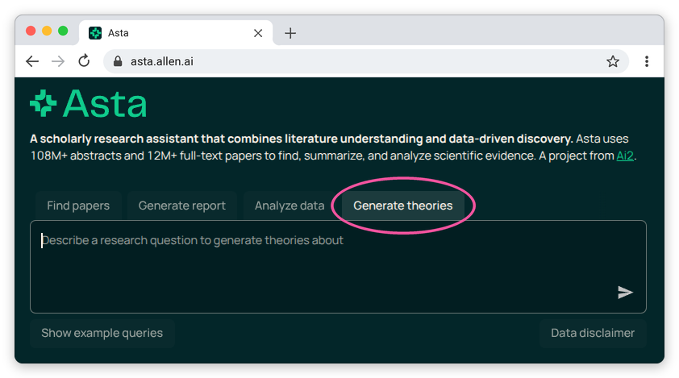
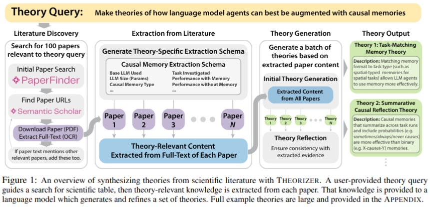
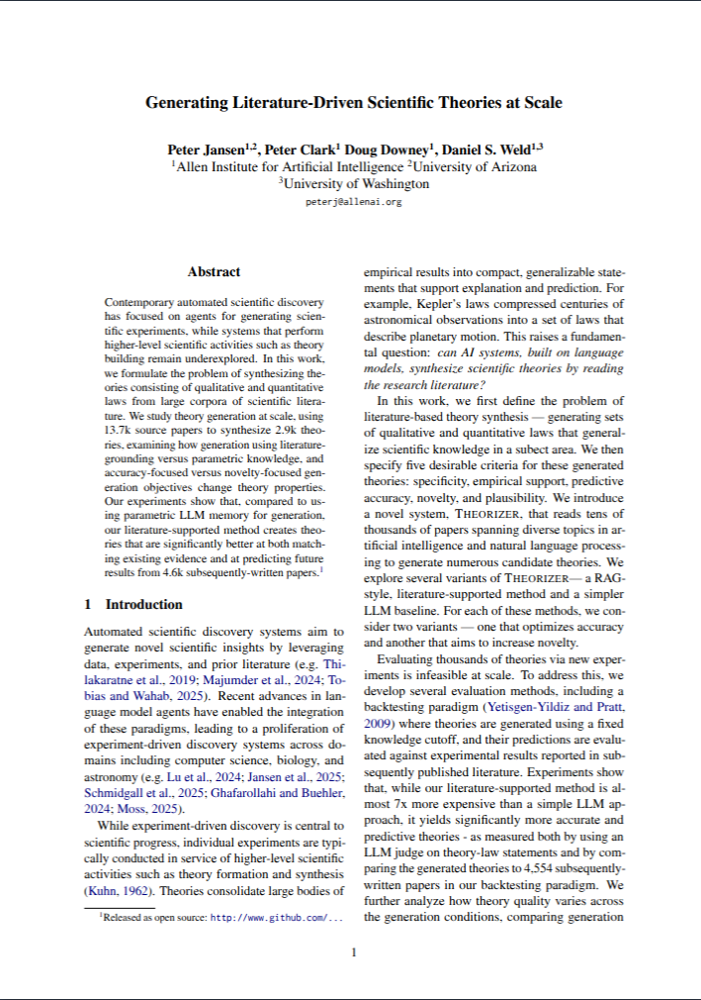

---

# Generating Literature-Driven Scientific Discoveries at Scale

This is the repository for Theorizer, from the paper [Generating Literature-Driven Scientific Theories at Scale (ACL 2026)](https://aclanthology.org/2026.acl-long.669/).

## 📢 News

- **[2026-11]** There are now three ways to use Theorizer:
  - 🌐 **On the web.** Theorizer is now available by using the **Generate Theories** tab on Asta ([asta.allen.ai](https://asta.allen.ai)). Sign up for a free account.<br><a href="#2-1-i-want-to-try-out-theorizer-can-i-try-it-out-quickly-on-the-web"></a>
  - 🐍 **As a Python library** (new in Theorizer 0.2.0), to run Theorizer from your own code, or use Theorizer with your favorite coding agent like Claude Code. Point your agent to the agent guide available here: [AGENTS.md](AGENTS.md).
  - 🗄️ **As the original stand-alone server** reported in the paper, [kept here for archival purposes](https://github.com/allenai/asta-theorizer/tree/c4802aa947128f1e49621d9a52891f612864716c).
- **[2026-07]** Theorizer was presented at [ACL 2026](https://2026.aclweb.org/) in San Diego.
- **[2026-04]** Our paper, [Generating Literature-Driven Scientific Theories at Scale](https://aclanthology.org/2026.acl-long.669/), was accepted to ACL 2026.

---

*Abstract:* Contemporary automated scientific discovery has focused on agents for generating scientific experiments, while systems that perform higher-level scientific activities such as theory building remain underexplored. In this work, we formulate the problem of synthesizing theories consisting of qualitative and quantitative laws from large corpora of scientific literature. We study theory generation at scale, using 13.7k source papers to synthesize 2.9k theories, examining how generation using literature-grounding versus parametric knowledge, and accuracy-focused versus novelty-focused generation objectives change theory properties. Our experiments show that, compared to using parametric LLM memory for generation, our literature-supported method creates theories that are significantly better at both matching existing evidence and at predicting future results from 4.6k subsequently-written papers.

<div align="center">

</div>

*Plain Language Overview:* Existing work in automated scientific discovery largely focuses on running new experiments, rather than higher-level scientific activities like theory building.  In this work we show language model agents can be used for theory building, too.  In normal usage, you provide a theory query (e.g. `build theories about X`), and the system uses this to find up to 100 papers related to that theory.  It reads each of these papers, extracts relevant evidence from them that might be useful for building theories, and then uses this evidence to synthesize about 4-8 theories per theory query.  How do you know if the generated theories are good theories?  There are a number of desirable qualities of theories, such as making accurate predictions of future scientific results, and of being new compared to previous theories.  We examine several methods of making theories, including using scientific literature versus only the language model's own knowledge, and asking the model to focus on making accurate theories, or new theories.  We made 100 theory queries broadly across different areas of AI and Natural Language Processing, and used these to synthesize approximately 3,000 theories from reading almost 14,000 papers.  What we found is that different methods of making theories affect their properties (like how accurate or novel they are), with some methods making theories that are (on average) 90% accurate at predicting future scientific results. 

---

# Table of Contents

- [1. Paper](#1-paper)
- [2. Quick Start](#2-quick-start)
  - [2.1. I want to try out Theorizer, can I try it out quickly on the web?](#2-1-i-want-to-try-out-theorizer-can-i-try-it-out-quickly-on-the-web)
  - [2.2. Is Theorizer limited to making theories in Computer Science/AI?](#2-2-is-theorizer-limited-to-making-theories-in-computer-scienceai)
  - [2.3. I want to read about Theorizer or generating theories from scientific literature](#2-3-i-want-to-read-about-theorizer-or-generating-theories-from-scientific-literature)
  - [2.4. I want to examine the theories, evaluations, and other results created by Theorizer for the Theorizer paper](#2-4-i-want-to-examine-the-theories-evaluations-and-other-results-created-by-theorizer-for-the-theorizer-paper)
  - [2.5. I want to run Theorizer on my local machine, on my own theory queries](#2-5-i-want-to-run-theorizer-on-my-local-machine-on-my-own-theory-queries)
  - [2.6. I have a question not answered here](#2-6-i-have-a-question-not-answered-here)
- [3. Installation and Running](#3-installation-and-running)
  - [3.1. Two modes: Web-based, or Local (Python Library)](#3-1-two-modes-web-based-or-local-python-library)
  - [3.2. Installation Instructions (Python Library or Claude Code)](#3-2-installation-instructions)
    - [3.2.1. Costs](#3-2-1-costs)
    - [3.2.2. Platforms](#3-2-2-platforms)
    - [3.2.3. API Keys](#3-2-3-api-keys)
    - [3.2.4. Installing the Library](#3-2-4-installing-the-library)
    - [3.2.5. Paper Search](#3-2-5-paper-search)
    - [3.2.6. Running Theorizer Code (with Agents)](#3-2-6-running-theorizer-code-with-agents)
- [4. Theory Evaluation](#4-theory-evaluation)
  - [4.1. LLM-as-a-judge evaluation](#4-1-llm-as-a-judge-evaluation)
  - [4.2. Predictive Accuracy Evaluation](#4-2-predictive-accuracy-evaluation)
  - [4.3. Qualified Novelty Evaluation](#4-3-qualified-novelty-evaluation)
  - [4.4. Self-assessed Belief / Bayesian Surprise](#4-4-self-assessed-belief--bayesian-surprise)
- [5. Data, Example Output, and Theorizer Representation Formats](#5-data-example-output-and-theorizer-representation-formats)
  - [5.1. Representation Formats](#5-1-representation-formats)
  - [5.2. Small / Toy Theory Dataset](#5-2-smalltoy-theory-dataset)
  - [5.3. Real Theory Dataset (from the Theorizer paper)](#5-3-real-theory-dataset-from-the-theorizer-paper)
- [6. Prompts](#6-prompts)
- [7. Citation](#7-citation)
- [8. License](#8-license)
- [9. Contact](#9-contact)

---

<span id="1-paper"/>

## 1. Paper 

*Theorizer* is described in the following paper: [Generating Literature-Driven Scientific Theories at Scale (ACL 2026)](https://aclanthology.org/2026.acl-long.669/).

<div align="center">
<table> <tr> <td>
        
</td> </tr> </table>
</div>

<span id="2-quick-start"/>


## 2. Quick Start

<span id="2-1-i-want-to-try-out-theorizer-can-i-try-it-out-quickly-on-the-web"/>

### 2.1. I want to try out Theorizer, can I try it out quickly on the web?
Yes!  Theorizer is now available on the web at [asta.allen.ai](https://asta.allen.ai).  Simply type your theory query into the **Generate Theories** tab.  If you do not already have a free Asta account, you will be prompted to create one.

<div align="center">

</div>

<span id="2-2-is-theorizer-limited-to-making-theories-in-computer-scienceai"/>

### 2.2. Is Theorizer limited to making theories in Computer Science/AI?
Theorizer can make theories in *any* domain, and has had success in generating theories in (for example) the biomedical domain.  The primary limitation is Theorizer's ability to get the full text of papers: the web-based version is limited to open-access papers, while the local/Python library version can also use paper PDFs that you personally have access to.

<span id="2-3-i-want-to-read-about-theorizer-or-generating-theories-from-scientific-literature"/>

### 2.3. I want to read about Theorizer or generating theories from scientific literature
The Theorizer paper is available here: [Section 1. Paper](#1-paper)

<span id="2-4-i-want-to-examine-the-theories-evaluations-and-other-results-created-by-theorizer-for-the-theorizer-paper"/>

### 2.4. I want to examine the theories, evaluations, and other results created by Theorizer for the Theorizer paper
- Real data (theories, theory queries, and evaluations) from the paper are available here: [Section 5.3. Real Theory Dataset (from the Theorizer paper)](#5-3-real-theory-dataset-from-the-theorizer-paper)
- Toy data (if you'd just like a small download, to examine the format) is available here: [Section 5.2. Small / Toy Theory Dataset](#5-2-smalltoy-theory-dataset)

<span id="2-5-i-want-to-run-theorizer-on-my-local-machine-on-my-own-theory-queries"/>

### 2.5. I want to run Theorizer on my local machine, on my own theory queries
Install the library (see [Section 3.2. Installation Instructions](#3-2-installation-instructions)), then follow [AGENTS.md](AGENTS.md): bring your papers, extract evidence, and generate theories.  A run over about 100 papers may take 30-60 minutes, depending on the rate limits of your API access and the speed of the models.  To try your theory queries without installing anything, use the web version: [Section 2.1](#2-1-i-want-to-try-out-theorizer-can-i-try-it-out-quickly-on-the-web).

<span id="2-6-i-have-a-question-not-answered-here"/>

### 2.6. I have a question not answered here. 
Please see the documentation below.  If you're question isn't answered, please add an issue, or send an e-mail: [Section 9. Contact](#9-contact)

<span id="3-installation-and-running"/>

## 3. Installation and Running

<span id="3-1-two-modes-web-based-or-local-python-library"/>

### 3.1. Two modes: Web-based, or Local (Python Library)

Theorizer can be used in two ways:

- **Web-based:** Theorizer is available on the web at [asta.allen.ai](https://asta.allen.ai).  Simply type your theory query into the **Generate Theories** tab.  If you do not already have a free Asta account, you will be prompted to create one.
- **Local (Python library):** Theorizer can also run on your own machine as a Python library, from your own code, or with your favorite coding agent like Claude Code.  Installation and running instructions are below.

<span id="3-2-installation-instructions"/>

### 3.2. Installation Instructions (Python Library or Claude Code)

<span id="3-2-1-costs"/>

#### 3.2.1. Costs
⚠️ Running Theorizer locally calls paid models using your own API keys.  Theory generation, evaluation and the per-paper stages (such as extraction) can incur significant costs.  Start small to gauge costs, and use API keys with hard limits to avoid unexpected overruns.

<span id="3-2-2-platforms"/>

#### 3.2.2. Platforms
The installation has been tested on Ubuntu Linux.  It will likely work with minimal modification on MacOS, and with some modification under Windows.

<span id="3-2-3-api-keys"/>

#### 3.2.3. API Keys
Theorizer reads its API keys from environment variables:
```
export OPENAI_API_KEY="sk-proj-..."          # and/or ANTHROPIC_API_KEY="sk-ant-..."
export SEMANTIC_SCHOLAR_API_KEY="..."
export MISTRAL_API_KEY="..."                 # optional: PDF conversion
```

- **Language models** (`OPENAI_API_KEY`, `ANTHROPIC_API_KEY`): the default models are OpenAI's; to use Anthropic's models instead, set them as described in [AGENTS.md](AGENTS.md#models).
- **Semantic Scholar** (`SEMANTIC_SCHOLAR_API_KEY`): used to fetch papers by their Semantic Scholar corpus id, and to look up paper metadata.  Without a key, Semantic Scholar limits requests to about one per second.
- **PDF conversion** (`MISTRAL_API_KEY`): if you would like to use a strong converter like Mistral OCR for converting PDFs to Markdown (particularly useful for papers that have equations, tables, or other details), add this as an API key.  Mistral OCR is also what `Pipeline.fetch_papers()` uses to convert the PDFs it downloads.  You can use any converter that you prefer, that matches your cost/performance requirements: convert your PDFs to Markdown with it, and import the Markdown files.

<span id="3-2-4-installing-the-library"/>

#### 3.2.4. Installing the Library
Install Theorizer from PyPI (requires Python 3.12 or later):
```
pip install asta-theorizer
```

Symbolic law discovery ([AGENTS.md, Workflow 3](AGENTS.md#workflow-3--symbolic-laws)) needs the `symbolic` extra: `pip install "asta-theorizer[symbolic]"`, or `uv sync --extra symbolic` in a clone.

If you want the latest development version, clone the repository and install its dependencies instead:
```
git clone https://github.com/allenai/asta-theorizer
cd asta-theorizer
uv sync
```

The PyPI package contains the library itself.  The agent guide ([AGENTS.md](AGENTS.md)), the [examples](examples/README.md) and the [workflow script](workflows/theorize.py) are in this repository.

<span id="3-2-5-paper-search"/>

#### 3.2.5. Paper Search
While the web-based version of Theorizer uses Asta PaperFinder [[Web UI](https://asta.allen.ai/discover?redirect_from=paper-finder)] [[Code](https://github.com/allenai/asta-paper-finder)] to autonomously search for papers relevant to your query, the local/Python version requires you to either:

1. **Search for papers, then fetch them:** find papers using a tool such as [Semantic Scholar](https://www.semanticscholar.org) (or have your coding agent search the [Semantic Scholar API](https://www.semanticscholar.org/product/api) for you), then pass their corpus ids to `Pipeline.fetch_papers()` (as `[{"corpus_id": "..."}]`), which downloads the open-access PDFs and converts them to text with Mistral OCR.  Theorizer's planning stage suggests a search query (`paper_search_query`) to start from.
2. **Bring your own papers:** import PDFs you have already downloaded, including ones you have access to through your institution, with `PaperImport.import_papers(path, ocr="mistral")`, which converts the PDFs with Mistral OCR.  Or convert them to Markdown first with a converter of your choice (see [API Keys](#3-2-3-api-keys)), and import the Markdown files with `PaperImport.import_papers(path)`.

Both are described in [AGENTS.md](AGENTS.md).

<span id="3-2-6-running-theorizer-code-with-agents"/>

#### 3.2.6. Running Theorizer Code (with Agents)

Theorizer can be run as a Python library, where the stages in the Theorizer pipeline (e.g. generating an extraction schema, extracting information from papers, synthesizing theories, and so forth) are all abstracted to different functions that can be orchestrated either in your own code, or by a coding agent.  For coding agents (like Claude Code), we supply a number of [example workflows](examples/README.md) that show how to string the pipeline together to go from a user's theory query all the way to a list of generated theories that have been exported in your preferred format.  One of the other benefits of running Theorizer with an agent is that you can tweak the workflow to your liking: manually inspect or modify the extraction schema, add more (or fewer) papers, generate large numbers of theories, cluster batches of theories to find those that particularly speak to your needs, and so forth -- all within your coding agent interface.

**Getting started with a coding agent:** point your agent to the agent guide, [AGENTS.md](AGENTS.md), either in your clone of this repository, or here on GitHub.  The guide describes every stage, how the stages connect, and the rules a run must follow (such as saving everything in the run's own directory).  For example:
```
Read AGENTS.md.  Then generate theories about how VIP interneurons control gain in
mouse primary visual cortex, from the papers in ~/papers/vip/, in a new run directory.
```

**Good places to start:**
- [`workflows/theorize.py`](workflows/theorize.py): one complete run, from a theory query to a saved store of theories, as a single script.  Copy it into a fresh, empty directory, edit its `PARAMETERS` block (your question, and where your papers are), and run it there.
- [`examples/`](examples/README.md): seven small, runnable scripts, each showing one part of the pipeline and what it costs.  For instance, `01_FirstRun.py` (the full pipeline), `02_BringYourOwnPapers.py` (your own papers), and `03_IteratingOnASchema.py` and `06_VariableDiscovery.py` (improving the extraction schema before running at scale).
- [AGENTS.md, Workflow 5](AGENTS.md#workflow-5--write-the-records-and-theories-yourself-no-model-calls): if you would like your agent to read the papers and write the evidence and theories itself, without Theorizer calling a model.


<span id="4-theory-evaluation"/>

## 4. Theory Evaluation

The following sections pertain to running the evaluation code used in the paper, and are not necessarily required for using Theorizer as a user, either on the web, or when using the Python library, but are supplied here for replicability purposes.

<span id="4-1-llm-as-a-judge-evaluation"/>

### 4.1. LLM-as-a-judge evaluation (Table 1)

Code: The LLM-as-a-judge evaluation code is in the paper code: [src/EvaluationLLMAsAJudge.py](https://github.com/allenai/asta-theorizer/blob/c4802aa947128f1e49621d9a52891f612864716c/src/EvaluationLLMAsAJudge.py)

Example output: 
```
...
LLM-as-a-judge evaluation complete.

Final average evaluation scores (formatted):
Dimension                      Average Score   Counts              
factual_accuracy               6.18            45                  
specificity                    7.36            45                  
novelty                        5.73            45                  
testability                    7.98            45                  
plausibility                   7.24            45                  
empirical_testing              2.69            45                  

Results saved to: ...
```

<span id="4-2-predictive-accuracy-evaluation"/>

### 4.2. Predictive Accuracy Evaluation (Table 2)

Code: the predictive accuracy evaluation needs a paper-search service, so it is not part of the library; it is in [src/EvaluationPredictiveAccuracy.py](https://github.com/allenai/asta-theorizer/blob/c4802aa947128f1e49621d9a52891f612864716c/src/EvaluationPredictiveAccuracy.py) in the paper code.

Example output: 
```
...
Summary of predictive accuracy evaluations:
Precision:
{
    "average_evaluation": {
        "support": 1.0,
        "contradict": 0.0,
        "count": 2
    }
}

Recall:
{
    "count_theories_has_data": 2,
    "count_theories_no_data": 0,
    "proportion_theories_with_data": 1.0,
    "count_elems_has_data": 6,
    "count_elems_no_data": 5,
    "proportion_elems_with_data": 0.5454545454545454
}

Other:
{
    "count_total_papers_evaluated": 20,
    "count_total_papers_with_relevant_info": 9,
    "avg_papers_with_relevant_info": 4.5,
    "count_total_laws_with_relevant_info": 2
}
Wrote summary to: theorystore-example-predictive-evaluation/predictive-accuracy-evaluation/claude_sonnet_4_5_20250929/predictive_accuracy_summary.json
Predictive accuracy evaluation complete.
```

<span id="4-3-qualified-novelty-evaluation"/>

### 4.3. Qualified Novelty Evaluation (Table 3)

Code: The qualified novelty evaluation code is in the paper code: [src/EvaluationQualifiedNovelty.py](https://github.com/allenai/asta-theorizer/blob/c4802aa947128f1e49621d9a52891f612864716c/src/EvaluationQualifiedNovelty.py)

Example output: 
```
...
Found 5 novelty evaluation files in: qualified-novelty-evaluations/literature-supported/
Novelty Evaluation Histogram:
{
    "path_in": "qualified-novelty-evaluations/literature-supported/",
    "histogram_proportions": {
        "phenomenon_effect": {
            "not_novel": 1.0,
            "novel": 0.0
        },
        "explanatory_mechanistic": {
            "not_novel": 0.2,
            "novel": 0.8
        },
        "unification": {
            "not_novel": 0.4,
            "novel": 0.6
        },
        "generalization_scope_expansion": {
            "not_novel": 0.4,
            "novel": 0.6
        },
        "constraint_limitation": {
            "not_novel": 1.0,
            "novel": 0.0
        },
        "conceptual_reframing_abstraction": {
            "not_novel": 0.6,
            "novel": 0.4
        },
        "empirical_synthesis_meta_regulariry": {
            "not_novel": 0.6,
            "novel": 0.4
        }
    },
    "histogram_raw_counts": {
        "phenomenon_effect": {
            "not_novel": 4,
            "novel": 0
        },
        "explanatory_mechanistic": {
            "not_novel": 1,
            "novel": 4
        },
        "unification": {
            "not_novel": 2,
            "novel": 3
        },
        "generalization_scope_expansion": {
            "not_novel": 2,
            "novel": 3
        },
        "constraint_limitation": {
            "not_novel": 5,
            "novel": 0
        },
        "conceptual_reframing_abstraction": {
            "not_novel": 3,
            "novel": 2
        },
        "empirical_synthesis_meta_regulariry": {
            "not_novel": 3,
            "novel": 2
        }
    },
    "total_cost_all_evaluations": 5.84496665,
    "num_evaluations": 5,
    "average_cost_per_evaluation": 1.16899333,
    "average_papers_per_evaluation": 23.0,
    "stddev_papers_per_evaluation": 0.0,
    "total_papers_evaluated": 115.0
}

Total Cost for all evaluations: $5.84
Number of evaluations: 5
Average Cost per evaluation: $1.17
Average Number of papers evaluated per evaluation: 23.00 ± 0.00
Total papers evaluated across all evaluations: 115
Writing overall qualified novelty evaluation summary to: theorystore-example2-literaturesupported-qualified-novelty-evaluation.20260114-121058.json
```

<span id="4-4-self-assessed-belief--bayesian-surprise"/>

### 4.4. Self-assessed Belief/Bayesian Surprise (Table 2)

Code: The self-assessed belief/Bayesian surprise evaluation code is in the paper code: [src/EvaluationSurprisal.py](https://github.com/allenai/asta-theorizer/blob/c4802aa947128f1e49621d9a52891f612864716c/src/EvaluationSurprisal.py)

Example output: 
```
Surprisal / Belief Elicitation evaluation complete.
--------------------------------------------------------------------------------

Total laws evaluated: 45
Model used: gpt-4.1-2025-04-14
Number of samples per law: 10
Average (of average) probability that the model believes the laws to be true: 0.809
Standard deviation of the average probabilities: 0.045

Results saved to: theorystore-example-single-laws.surprise_evaluated.20260114-104415.json
```

<span id="5-data-example-output-and-theorizer-representation-formats"/>

## 5. Data, Example Output, and Theorizer Representation Formats

<span id="5-1-representation-formats"/>

### 5.1. Representation Formats

The primary data structure saved by Theorizer is the `TheoryStore`.  At a top-level, dictionary contains the following keys:

- `theories`: A dictionary of theories, each containing their high-level descriptions, components, and lists of theory laws/statements.
- `extraction_schemas`: A dictionary of extraction schemas built for extracting evidence from papers.
- `extraction_results`: A dictionary of specific extraction results -- that is, using an extraction schema to extract evidence from a paper.
 
Theorizer also generates a secondary data structure, the `PaperStore`, which is a cache of the papers Theorizer has downloaded and extracted the full text of using the OCR converter. 

<span id="5-2-smalltoy-theory-dataset"/>

### 5.2. Small/Toy Theory Dataset

Two small sets of theories, one generated using literature support, and one using parametric knowledge, along with sample evaluations, are provided in: [example-theories/toy-data](example-theories/toy-data) 

While the JSON is provided, the easiest way to view the example theories is in HTML format: [example-theories/toy-data/html/index.html](example-theories/toy-data/html/index.html) 

Please note that these toy theories are provided primarily as format examples, as small downloads.  The PaperStores are not included due to copyright, and any paper full-text is sanitized from the evaluation files. 

<span id="5-3-real-theory-dataset-from-the-theorizer-paper"/>

### 5.3. Real Theory Dataset (from the Theorizer paper)

The theories generated in the paper are available here: [example-theories/theorizer-paper-data](example-theories/theorizer-paper-data) 

<span id="6-prompts"/>

## 6. Prompts

The core prompts used in this work can be found at the following locations in the source:

*Schema Generation Prompts:*
- Converting a theory query into a schema: [src/TheorizerProcessing.py#L18](https://github.com/allenai/asta-theorizer/blob/c4802aa947128f1e49621d9a52891f612864716c/src/TheorizerProcessing.py#L18)

*Prompts for Extracting Evidence from Papers:*
- Populating a schema with evidence from one paper: [src/SchemaExtractionQueue.py#L285](https://github.com/allenai/asta-theorizer/blob/c4802aa947128f1e49621d9a52891f612864716c/src/SchemaExtractionQueue.py#L285)

*Theory Generation Prompts:*
- Theory Generation (accuracy-focused, with literature): [src/TheorizerProcessing.py#L227](https://github.com/allenai/asta-theorizer/blob/c4802aa947128f1e49621d9a52891f612864716c/src/TheorizerProcessing.py#L227)
- Theory Generation (accuracy-focused, with parametric knowledge): [src/TheorizerProcessing.py#L688](https://github.com/allenai/asta-theorizer/blob/c4802aa947128f1e49621d9a52891f612864716c/src/TheorizerProcessing.py#L688)
- Theory Generation (novelty-focused, with literature): [src/TheorizerProcessing.py#L1202](https://github.com/allenai/asta-theorizer/blob/c4802aa947128f1e49621d9a52891f612864716c/src/TheorizerProcessing.py#L1202)
- Theory Generation (novelty-focused, with parametric knowledge): [src/TheorizerProcessing.py#L1590](https://github.com/allenai/asta-theorizer/blob/c4802aa947128f1e49621d9a52891f612864716c/src/TheorizerProcessing.py#L1590)

*Evaluation: LLM-as-a-judge (Table 1):*
- LLM-as-a-judge prompt: [src/EvaluationLLMAsAJudge.py#L26](https://github.com/allenai/asta-theorizer/blob/c4802aa947128f1e49621d9a52891f612864716c/src/EvaluationLLMAsAJudge.py#L26)

*Evaluation: Predictive Accuracy (Table 2):*
- In [src/EvaluationPredictiveAccuracy.py](https://github.com/allenai/asta-theorizer/blob/c4802aa947128f1e49621d9a52891f612864716c/src/EvaluationPredictiveAccuracy.py) in the paper code (not part of the library): finding evaluation papers, building the prediction rubric, and scoring one paper with it.

*Evaluation: Qualified Novelty (Table 3):*
- Qualified Novelty assessment (one paper): [src/EvaluationQualifiedNovelty.py#L25](https://github.com/allenai/asta-theorizer/blob/c4802aa947128f1e49621d9a52891f612864716c/src/EvaluationQualifiedNovelty.py#L25)
- Qualified Novelty assessment (aggregate results across papers): [src/EvaluationQualifiedNovelty.py#L393](https://github.com/allenai/asta-theorizer/blob/c4802aa947128f1e49621d9a52891f612864716c/src/EvaluationQualifiedNovelty.py#L393)

*Evaluation: Self-assessed Belief/Bayesian Surprise (Table 2):*
- Self-assessed belief: [src/EvaluationSurprisal.py#L25](https://github.com/allenai/asta-theorizer/blob/c4802aa947128f1e49621d9a52891f612864716c/src/EvaluationSurprisal.py#L25)


<span id="7-citation"/>

## 7. Citation
If you use this work, please reference the following citation:
```
@inproceedings{jansen-etal-2026-generating,
    title = "Generating Literature-Driven Scientific Theories at Scale",
    author = "Jansen, Peter  and
      Clark, Peter  and
      Downey, Doug  and
      Weld, Daniel S",
    editor = "Liakata, Maria  and
      Moreira, Viviane P.  and
      Zhang, Jiajun  and
      Jurgens, David",
    booktitle = "Proceedings of the 64th Annual Meeting of the {A}ssociation for {C}omputational {L}inguistics (Volume 1: Long Papers)",
    month = jul,
    year = "2026",
    address = "San Diego, California, United States",
    publisher = "Association for Computational Linguistics",
    url = "https://aclanthology.org/2026.acl-long.669/",
    doi = "10.18653/v1/2026.acl-long.669",
    pages = "14677--14698",
    ISBN = "979-8-89176-390-6",
    abstract = "Contemporary automated scientific discovery has focused on agents for generating scientific experiments, while systems that perform higher-level scientific activities such as theory building remain underexplored. In this work, we formulate the problem of synthesizing theories consisting of qualitative and quantitative laws from large corpora of scientific literature. We study theory generation at scale, using 13.7k source papers to synthesize 2.9k theories, examining how generation using literature-grounding versus parametric knowledge, and accuracy-focused versus novelty-focused generation objectives change theory properties. Our experiments show that, compared to using parametric LLM memory for generation, our literature-supported method creates theories that are significantly better at both matching existing evidence and at predicting future results from 4.6k subsequently-written papers."
}
```

<span id="8-license"/>

## 8. License

Theorizer is released under an Apache 2.0 License.  The text of that license is included in this repository.

```
Disclaimer of Warranty. Unless required by applicable law or
agreed to in writing, Licensor provides the Work (and each
Contributor provides its Contributions) on an "AS IS" BASIS,
WITHOUT WARRANTIES OR CONDITIONS OF ANY KIND, either express or
implied, including, without limitation, any warranties or conditions
of TITLE, NON-INFRINGEMENT, MERCHANTABILITY, or FITNESS FOR A
PARTICULAR PURPOSE. You are solely responsible for determining the
appropriateness of using or redistributing the Work and assume any
risks associated with Your exercise of permissions under this License.
```

<span id="9-contact"/>

## 9. Contact

For any questions, please contact Peter Jansen (`peterj@allenai.org`).  For issues, bugs, or feature requests, please submit a [github issue](https://github.com/allenai/asta-theorizer/issues).

